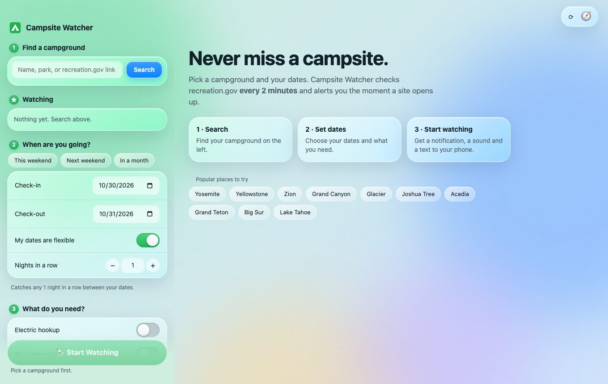
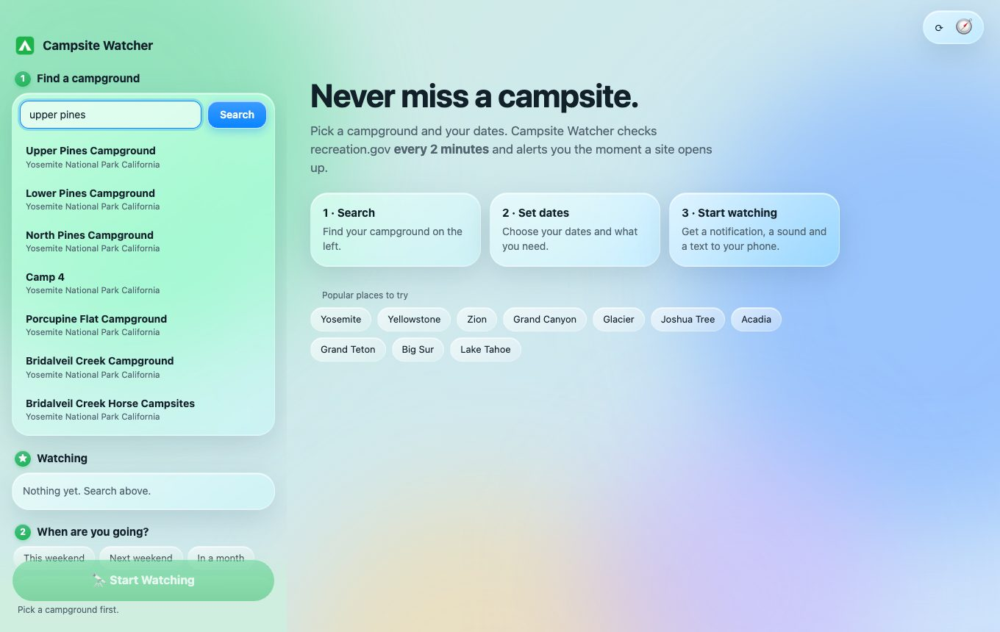
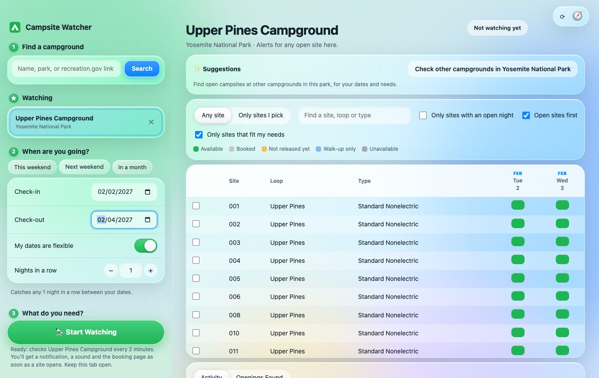
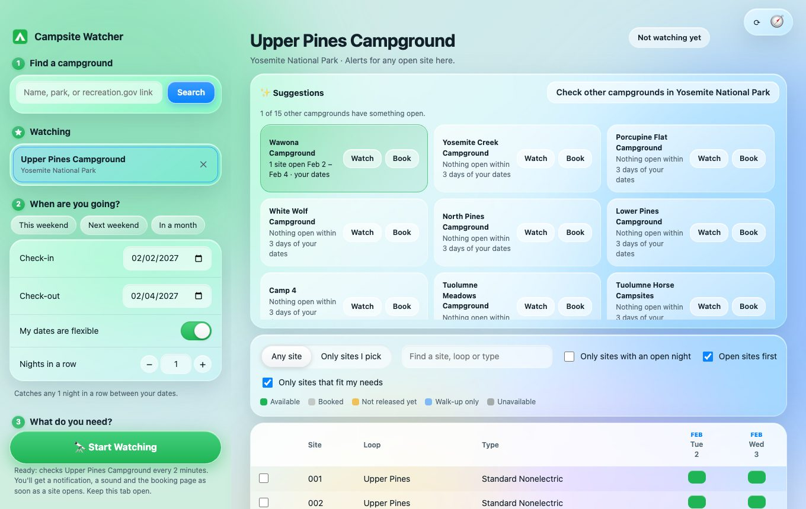
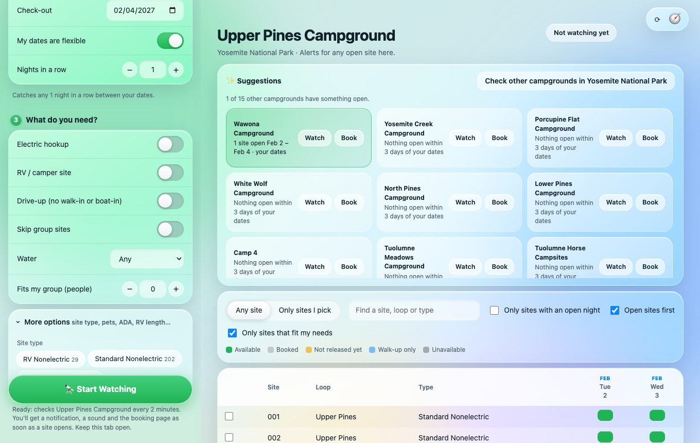
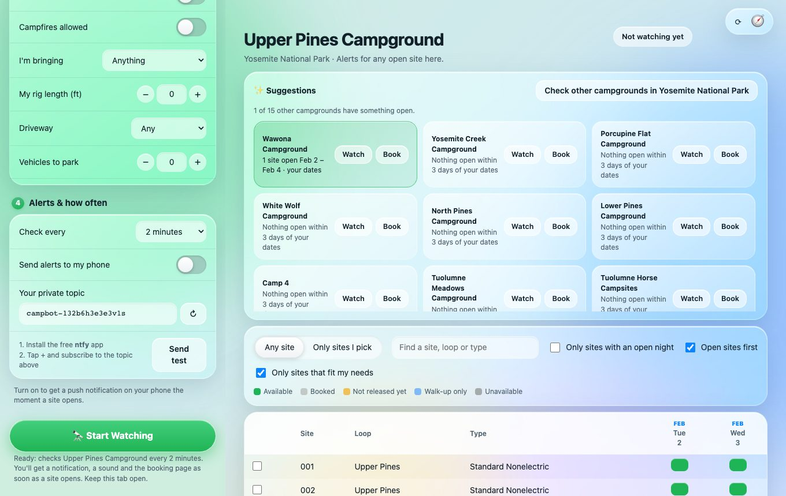
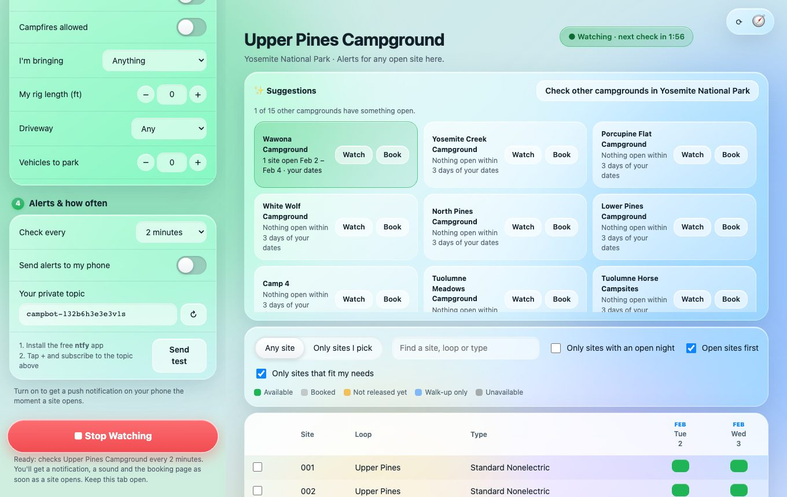

# Campsite Watcher

**Use it in your browser, no download: https://campsite-watcher-vs4b.onrender.com**

Prefer your own copy? [Run it on your computer](#run) or [deploy your own website](#website-version-no-download).


Watches a [recreation.gov](https://www.recreation.gov) campground and alerts you (notification, sound, and the booking page opening) when a site opens up for your dates.

- Search by campground name or paste a recreation.gov link
- Pick dates, flexible or exact, and number of nights in a row
- Filter by electric hookup, RV, drive-up, group sites and group size
- Live availability grid; watch any site or only the sites you tick
- Choose how often to check: every 30 seconds up to every 30 minutes (default 2 minutes)
- More options: site type, loop, ADA-accessible, pets, campfires, equipment (tent/RV/trailer...), rig length, driveway type, number of vehicles
- Phone alerts through [ntfy](https://ntfy.sh): install the free ntfy app, subscribe to the private topic shown in the app, and turn alerts on

## How to use the website

Open **https://campsite-watcher-vs4b.onrender.com** in any browser (Chrome, Safari, Firefox, on a computer or phone).

> The first visit after a quiet spell can take up to a minute to load, because the free host goes to sleep when nobody is using it. Just wait; later pages are instant.

### 1. Open the site
You land on the welcome screen. The panel on the left is where you set everything up. The big area on the right shows the campsites.



### 2. Find your campground
Type a campground or park name (for example `upper pines`) in the **Find a campground** box on the left, or tap one of the popular places. You can also paste a recreation.gov campground link. Tap your campground in the results.



### 3. Pick your dates
Tap **This weekend**, **Next weekend** or **In a month**, or choose your own check-in and check-out dates. The grid on the right shows every campsite and its nights: green is available, grey is booked.

Keep **My dates are flexible** on to be alerted for any night in your range, or turn it off to need every night.



### Nothing open? Check the rest of the park
Press **Check other campgrounds in …** in the Suggestions box. It looks up the park's other campgrounds, checks them for your dates and needs (and up to 3 days either side), and shows what's open in green. Tap **Watch** to switch to one, or **Book** to open recreation.gov.



### 4. Say what you need
Under **What do you need?**, switch on what matters: electric hookup, RV site, water, group size and more. Open **More options** for site type, pets, wheelchair access, campfires, rig length and driveway type. The grid updates as you go.



### 5. Set up alerts (optional)
Under **Alerts & how often**, choose how often to check (every 2 minutes is a good default). To get alerts on your phone, install the free **ntfy** app, tap **+**, enter the private topic shown here, then turn on **Send alerts to my phone** and tap **Send test**.



### 6. Start watching
Press the green **Start Watching** button. The label at the top turns green and counts down to the next check. When a site opens you get a notification, a sound, a message on your phone (if set up), and the booking page opens. You still book on recreation.gov yourself.

**Keep the browser tab open** while watching. The website only checks while the page is open.



## Run

Requires [Node.js](https://nodejs.org) 18 or newer. No dependencies to install.

```
npm start
```

Then open http://localhost:3000. Or run `npm install && npm run app` for the desktop window, and `npm run build` to make a Mac app. Keep the tab open while watching; allow notifications when asked.

## Notes

- recreation.gov doesn't allow calls straight from a web page, so `server.js` runs locally and relays requests to it. That's why this can't be hosted on GitHub Pages alone.
- Uses recreation.gov's unofficial website API, which may change. The bot only reads availability; you book on recreation.gov yourself.

## Website version (no download)

The app can also run as a website that anyone opens in a browser. It needs a small always-on server (recreation.gov blocks pages from calling it directly), so it can't live on GitHub Pages. This repo includes a ready config for [Render](https://render.com)'s free plan:

[](https://render.com/deploy?repo=https://github.com/bb520xx-code/Campsite-Watcher)

1. Click the button and sign in to Render (connect GitHub when asked).
2. Accept the defaults and click **Apply**. A minute later you get a link like `https://campsite-watcher-xxxx.onrender.com`.
3. Share that link.

How the website version differs from the Mac app:

- **Watching only happens while the page is open in a browser tab.** Close the tab and checks stop (the Mac app keeps checking in the background). Phone alerts, if enabled, still arrive on your phone while the tab is open.
- Each visitor's watches and phone topic are saved only in their own browser. Nothing is shared between visitors.
- Phone alerts go straight from the visitor's browser to ntfy.sh, never through the server.
- All visitors share one server, so heavy use can make recreation.gov rate-limit it. The server limits each visitor to 240 requests a minute (`RATE_LIMIT` to change).
- Render's free plan sleeps after 15 minutes without visits, so the first load can take about 30 seconds.
- Hosting from a data-center address is not guaranteed to be accepted by recreation.gov. If searches fail on the hosted site but work on your computer, that's why.
